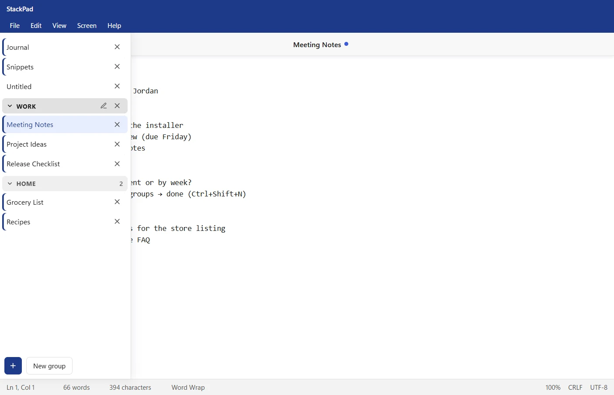

<p align="center">
  
</p>

<h1 align="center">StackPad</h1>

<p align="center">
  A lightweight notepad for Windows and Linux with vertical tabs, tab groups, window size presets and a calm light/dark design.
</p>

<p align="center">
  <a href="https://arafatanam.github.io/StackPad/"><strong>Website &amp; download</strong></a> ·
  <a href="CHANGELOG.md">Release notes</a> ·
  <a href="PRIVACY.md">Privacy</a> ·
  <a href="https://github.com/arafatanam/StackPad/issues/new/choose">Report a problem</a>
</p>

<p align="center">
  
</p>

---

## Why StackPad?

StackPad started from two small frustrations with the standard Windows Notepad:

1. **Tabs belong on the side.** A horizontal tab strip runs out of room quickly and squeezes every title. StackPad keeps your notes in a vertical rail that stays slim while you write and opens to show full titles when you need them.
2. **The window should snap to a size you like.** StackPad has one-click **4:5** and **16:9** window presets, plus **Freeform** for everything else.

Everything else follows the same idea: keep the essentials of a plain-text notepad, and make them feel faster and tidier.

## StackPad vs. Windows Notepad

Both apps are plain-text editors with tabs, find and replace, themes and session restore. These are the areas where StackPad works differently:

| Area                   | Windows Notepad                                    | StackPad                                                                                                                                                             |
| ---------------------- | -------------------------------------------------- | -------------------------------------------------------------------------------------------------------------------------------------------------------------------- |
| **Tab layout**         | Horizontal tab strip across the top                | Vertical rail on the left that expands over the editor on hover, so the text never shifts or re-wraps                                                                |
| **Telling tabs apart** | Tab titles                                         | Each tab gets an initials badge in its own colour (e.g. **MN** for _Meeting Notes_). The colour stays with the tab even if you rename it                             |
| **Window size**        | Resize by hand                                     | One-click **4:5** and **16:9** presets, plus **Freeform**, which remembers your size and position                                                                    |
| **Find & replace**     | Find and replace panel                             | Compact controls that take the title's place in the toolbar, with a live "3 of 12" count, match case, whole word and an in-text highlight that follows wrapped lines |
| **Status bar**         | Position, characters, zoom, line endings, encoding | Also shows a live **word count**                                                                                                                                     |
| **Online features**    | Includes features linked to a Microsoft account    | No account, no sign-in, no AI features, no telemetry. The only connection is an update check, which you can turn off                                                 |
| **Source**             | Closed source                                      | Open source (MIT), so you can change anything                                                                                                                        |

## Features

### Tabs

- Vertical tab rail with initials badges while collapsed; untitled tabs show a page icon
- Badge colours are spread across a palette of 8, so neighbouring tabs rarely match
- Expand the rail by hovering it; it slides over the editor instead of pushing it
- Drag tabs up and down to reorder them
- Organise tabs into named groups that fold away: drag a tab under a group to add it, or above the first group to take it out, and drag a group's header to reorder the groups
- Rename by double-clicking a tab or the centred title above the editor
- `Ctrl+Tab` / `Ctrl+Shift+Tab` cycles through tabs

### Never lose a note

- Every tab and its contents are kept between sessions, including tabs you never saved to a file
- Typing is saved continuously, and the last keystrokes are saved even if you close the app immediately
- Unsaved changes are marked with a notch on the tab's left edge when the rail is open, and a dot next to the title above the editor
- Closing a tab with unsaved changes asks **Save / Don't Save / Cancel**
- App data and your own files are written safely: the new version is saved in full before it replaces the old one, so a crash or power cut can't leave anything half-written
- If another program changes a file you have open, StackPad reloads it, or asks first if you have unsaved changes

### Writing and editing

- Undo and redo work for everything, including Replace All, Time/Date and Tab
- `Tab` inserts a real tab character (shown 4 spaces wide)
- Insert the current time and date with `F5`
- Word wrap on or off, Go To line (`Ctrl+G`)
- Font family and size, plus zoom with `Ctrl` + mouse wheel or `Ctrl` `+` / `-` / `0`

### Find and replace

- Search starts from your cursor and jumps to matches as you type
- Live count ("3 of 12"), previous/next with wrap-around, `F3` / `Shift+F3`
- **Match case** and **Match whole word** toggles inside the search box
- Replace the current match (`Enter` in the Replace box) or all matches (`Ctrl+Enter`)
- A highlight follows matches that wrap across lines

### Files

- Open several files at once, drag files onto the window, or right-click a `.txt` in Explorer and choose **Open with → StackPad**
- Files opened while StackPad is running appear as new tabs in the same window
- Opening a file that's already open switches to its tab instead of duplicating it
- Files are saved back with their original **line endings** (Windows CRLF or Unix LF) and **encoding** (UTF-8, UTF-8 with BOM, UTF-16, ANSI). If you add characters ANSI can't store, the file is saved as UTF-8 instead of losing them
- Print outputs the whole note on its own, without the app interface
- Read-only files are never overwritten; symbolic links, hard links and Linux file permissions are kept when saving

### Look and feel

- Light, Dark or follow Windows; both themes share the same blue accent
- Status bar with line/column, words, characters, zoom, line endings and encoding (can be hidden)
- Subtle motion for menus, dialogs, tabs and the find bar; turned off automatically when Windows **Animation effects** is off
- The window opens at your saved size and theme without a white flash

### Updates and help

- StackPad updates itself: new versions download in the background and install when you close the app (Windows installer and Linux AppImage). The .deb version tells you when an update is out
- **Help** menu with the website, keyboard shortcuts, release notes, **Report a Problem** (with your version filled in), **Check for Updates** and **About StackPad**

## Keyboard shortcuts

| Action                                     | Shortcut                                                       |
| ------------------------------------------ | -------------------------------------------------------------- |
| New tab                                    | `Ctrl+N`                                                       |
| New group                                  | `Ctrl+Shift+N`                                                 |
| Open                                       | `Ctrl+O`                                                       |
| Save / Save As                             | `Ctrl+S` / `Ctrl+Shift+S`                                      |
| Print                                      | `Ctrl+P`                                                       |
| Close tab                                  | `Ctrl+W`                                                       |
| Next / previous tab                        | `Ctrl+Tab` / `Ctrl+Shift+Tab`                                  |
| Find                                       | `Ctrl+F`                                                       |
| Find next / previous                       | `F3` / `Shift+F3` (or `Enter` / `Shift+Enter` in the find box) |
| Replace                                    | `Ctrl+H`                                                       |
| Replace current / all (in the Replace box) | `Enter` / `Ctrl+Enter`                                         |
| Close find or replace                      | `Esc`                                                          |
| Go to line                                 | `Ctrl+G`                                                       |
| Insert time and date                       | `F5`                                                           |
| Undo / Redo                                | `Ctrl+Z` / `Ctrl+Y`                                            |
| Zoom in / out / reset                      | `Ctrl` `+` / `Ctrl` `-` / `Ctrl+0`, or `Ctrl` + mouse wheel    |

## Installing StackPad

Download the latest version from the **[StackPad website](https://arafatanam.github.io/StackPad/#download)** or the [Releases page](https://github.com/arafatanam/StackPad/releases/latest).

### Windows

1. Download `StackPad.v2.2.0.exe` and run it. The setup wizard walks you through:
   - the license agreement,
   - installing **for just you** or **for everyone on this PC**,
   - choosing the install folder,
   - a final page with **Run StackPad** ticked.
2. StackPad is added to the Start menu and the desktop, and appears under **Open with** for `.txt` files.

To uninstall, use **Settings → Apps → Installed apps → StackPad → Uninstall**. Your notes are kept unless you delete them yourself (see below).

> Until the installer is code-signed, Windows SmartScreen may warn about an unrecognised app. Choose **More info → Run anyway** to continue. See [docs/SIGNING.md](docs/SIGNING.md) for the signing plan.

### Linux

**AppImage** (any distribution, updates itself):

```bash
chmod +x StackPad.v2.2.0.AppImage
./StackPad.v2.2.0.AppImage
```

AppImages need FUSE. If it won't start, install it first (`sudo apt install libfuse2` on Ubuntu and Debian).

**.deb** (Ubuntu, Debian, Mint and similar):

```bash
sudo apt install ./StackPad.v2.2.0.deb
```

### Updating from 2.1.0

Version 2.1.0 can't update itself, so install 2.2.0 once over it. Your notes are kept. From then on, updates arrive automatically.

## Building from source

Requirements: Windows 10/11 or Linux, [Node.js](https://nodejs.org/) 20 or newer, and npm.

```bash
npm install     # install dependencies
npm start       # run StackPad in development mode
npm test        # run the automated tests
npm run dist    # build the installer for your system
```

On Windows, `npm run dist` creates `dist/StackPad.v<version>.exe`, the setup wizard described above. The first build may need **Developer Mode** turned on (Settings → System → For developers) or an Administrator terminal, because electron-builder creates symbolic links while preparing its tools. If the build stops with `status code 504`, GitHub's download servers failed while fetching those tools; run it again.

Linux files can't be built on Windows, so GitHub Actions builds them (see [.github/workflows/build.yml](.github/workflows/build.yml)). Pushing a version tag such as `v2.3.0` tests and builds everything and creates a draft release with the installers and the update files attached. The full release steps are in [CONTRIBUTING.md](CONTRIBUTING.md#making-a-release-maintainers).

macOS isn't a release target, though StackPad can be run from source there with `npm start`.

## Where your notes are stored

StackPad keeps its data in `%APPDATA%\stackpad` on Windows and `~/.config/stackpad` on Linux:

| File               | Contents                                                                  |
| ------------------ | ------------------------------------------------------------------------- |
| `drafts\*.txt`     | The text of every open tab                                                |
| `notes-index.json` | Tab order, titles, badge colours, each tab's group and linked file paths  |
| `settings.json`    | Theme, font, zoom, word wrap, status bar, screen size, window position, tab groups and the automatic update setting |

Files you save with **Save / Save As** live wherever you put them. The drafts are StackPad's own copy, so tabs you never saved to a file are still there next time.

## Project structure

```text
stackpad/
├── .github/
│   ├── workflows/build.yml   # tests, builds and (optionally) signs the installers
│   ├── workflows/pages.yml   # publishes the website
│   └── ISSUE_TEMPLATE/       # bug report and feature request forms
├── build/                    # app icons, installer artwork and Microsoft Store tiles
├── docs/SIGNING.md           # code signing and Microsoft Store guide
├── lib/
│   ├── textfile.js           # encodings, line endings and crash-safe saving
│   └── updater.js            # automatic updates
├── scripts/                  # release helpers used by CI
├── src/
│   ├── index.html            # window layout, menus and dialogs
│   ├── renderer.js           # tabs, editor, find/replace, saving, settings
│   └── styles.css            # themes, layout and motion
├── test/                     # automated tests (npm test)
├── website/                  # the project website (GitHub Pages)
├── main.js                   # window, native menu, file reading/writing, storage
├── preload.js                # the safe bridge between the window and main.js
└── package.json              # scripts and installer configuration
```

## Release notes

See [CHANGELOG.md](CHANGELOG.md).

## Contributing

Bug reports, ideas and pull requests are welcome. See [CONTRIBUTING.md](CONTRIBUTING.md). Please report security problems privately, as described in [SECURITY.md](SECURITY.md).

## License

[MIT](LICENSE) © 2026 Arafat Anam Chowdhury
